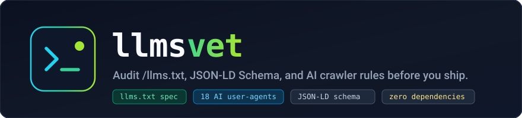

<div align="center">



### Audit `/llms.txt`, JSON-LD structured data, and AI crawler access rules from a single zero-dependency CLI.

[](https://github.com/SuzumiyaHaruhi719/llmsvet/actions/workflows/ci.yml)
[](https://github.com/SuzumiyaHaruhi719/llmsvet/releases)
[](LICENSE)
[](https://github.com/SuzumiyaHaruhi719/llmsvet/releases)


</div>

---

## Why

Teams block `GPTBot` or `User-agent: *` in `robots.txt` to opt out of model training, then wonder why their documentation disappears from ChatGPT Search, Perplexity, and Claude citations. Others publish an `/llms.txt` file that breaks the `llmstxt.org` Markdown structure, points to dead relative links, or ships pages without `FAQPage`, `TechArticle`, or `SoftwareApplication` JSON-LD markup.

`llmsvet` checks both **live URLs** and **local static build folders** (`./dist`, `./public`, `./out`) in milliseconds. It scores your site from 0 to 100, separates **AI training crawlers** from **AI search/citation crawlers**, and writes ready-to-commit fix files.

## Features

- **Training vs. Search Crawler Split**: Evaluates `robots.txt` (RFC 9309 wildcard `*`, `$` anchors, longest-path precedence) across **18 AI user-agents**, flagging when you accidentally block search/citation bots (`OAI-SearchBot`, `ChatGPT-User`, `PerplexityBot`, `Claude-SearchBot`, `DuckAssistBot`) while trying to block training scrapers (`GPTBot`, `CCBot`, `ClaudeBot`, `Google-Extended`, `Bytespider`).
- **`/llms.txt` & `/llms-full.txt` Conformance**: Verifies the required H1 title, summary blockquote, H2 link sections, Markdown link syntax, `Optional` section behavior, token footprint estimate, and local/remote link targets.
- **JSON-LD & HTML Metadata Inspection**: Parses `<script type="application/ld+json">` (including `@graph` arrays), checks high-citation Schema.org types (`SoftwareApplication`, `TechArticle`, `Article`, `FAQPage`, `Organization`, `WebSite`, `BreadcrumbList`), and inspects `<title>`, canonical URLs, meta descriptions, and `X-Robots-Tag` / `<meta name="robots">` (`noai`, `noindex`).
- **Ready-to-Deploy Fix Generator (`--emit-fixes`)**: Generates a valid `llms.txt` starter, a split-policy `robots.txt` block (allow search citations, block training, or allow all), and missing JSON-LD `<script>` snippets derived from your actual HTML metadata.
- **CI Gate Ready**: Runs offline against `./dist` or `./public` before deployment with `--fail-under <score>` and `--format table|json|markdown`.
- **Zero Runtime Dependencies**: Pure Python 3.9+ standard library. Works identically on Linux, macOS, and Windows without API keys or headless browsers.

## Quickstart

Install with one command directly from GitHub (or run via `pipx` / `uvx`):

```bash
pip install git+https://github.com/SuzumiyaHaruhi719/llmsvet.git
```

1. **Audit a live website or local build folder**:
   ```bash
   llmsvet audit https://docs.python.org
   llmsvet audit ./dist
   ```
2. **Generate ready-to-use fix files** (`llms.txt`, `robots.txt.patch`, `schema.jsonld.html`):
   ```bash
   llmsvet audit ./dist --emit-fixes ./llmsvet-fixes --policy search-only
   ```
3. **Enforce a minimum score in CI**:
   ```bash
   llmsvet audit ./dist --fail-under 85
   ```

## Usage Examples

### Audit a local Next.js / Astro / VitePress build output

```bash
llmsvet audit ./public --policy search-only
```

- `--policy search-only` *(default)*: Rewards allowing AI search/citation bots (`OAI-SearchBot`, `PerplexityBot`, `Claude-SearchBot`) regardless of whether training bots (`GPTBot`, `CCBot`) are blocked, and warns if search bots are blocked while training bots are left open.
- `--policy open`: Rewards allowing both AI search and training crawlers.
- `--policy strict-block`: Verifies that both training and AI search crawlers are blocked when auditing private/paywalled portals.

### Export JSON or Markdown reports for pull request comments

```bash
llmsvet audit https://example.com --format json > report.json
llmsvet audit ./dist --format markdown > pr-comment.md
```

### Validate a standalone `llms.txt` file

```bash
llmsvet check-llms ./public/llms.txt
```

### Inspect how your `robots.txt` treats all 18 AI crawlers

```bash
llmsvet check-robots ./public/robots.txt
```

## Comparison with Alternatives

| Capability | `llmsvet` | `turva-llms-txt-validator` | `open-geo` | `claude-seo` |
|---|---|---|---|---|
| License & runtime | MIT, Python stdlib (0 deps) | MIT, Node.js (0 deps) | Open source, Node.js | Open source, Claude Code skill |
| Audits `/llms.txt` spec | Yes (H1, quote, H2 links, tokens) | Yes (8 structure checks) | Yes | Yes (via LLM prompt) |
| Audits `robots.txt` AI bots | Yes (18 bots, RFC 9309 wildcards) | Not supported | Basic bot check | Yes (via LLM prompt) |
| Splits Training vs. Search bots | Yes (`OAI-SearchBot` vs `GPTBot`) | Not supported | Partial | Manual prompt analysis |
| Audits JSON-LD Schema.org | Yes (`@graph`, required fields) | Not supported | Yes | Yes |
| Offline local folder mode (`./dist`) | Yes (pre-deploy CI ready) | Single file only | Live URLs primarily | Live URLs / local files |
| Generates drop-in fix files | Yes (`--emit-fixes`) | Validation only | Generates `llms.txt` | Suggests edits in chat |
| Deterministic & zero API keys | Yes | Yes | Probe mode uses LLM APIs | Requires Claude subscription |

## FAQ

**Does `llmsvet` make any external API calls or send my HTML anywhere?**
Never. Auditing a local directory is 100% offline. Auditing an `http://` or `https://` URL only fetches `<origin>/`, `<origin>/robots.txt`, `<origin>/llms.txt`, and `<origin>/llms-full.txt` directly from that target origin.

**Why did my site lose points for blocking `OAI-SearchBot` when I only wanted to opt out of OpenAI model training?**
OpenAI uses separate user-agents: `GPTBot` crawls content for foundation model training, while `OAI-SearchBot` and `ChatGPT-User` power search results and live citations. Blocking `User-agent: *` without an explicit `Allow: /` rule for `OAI-SearchBot`, `PerplexityBot`, and `Claude-SearchBot` removes your site from AI search citations. Run `llmsvet audit ./public --emit-fixes ./fixes --policy search-only` to generate the exact `robots.txt` rules.

**How is the 0-100 score weighted?**
- **AI Crawler Access (`robots.txt` & meta directives)**: 35 points
- **`/llms.txt` & `/llms-full.txt` Readiness**: 35 points
- **Structured Data (JSON-LD Schema.org) & HTML Citability**: 30 points

Every deduction lists the exact rule ID, evidence line, and remediation step.

**Does it work on Windows?**
Yes. `llmsvet` uses `pathlib` and pure Python standard library modules, with ANSI color fallback when `NO_COLOR` is set or stdout is redirected.

## Roadmap

- [x] v0.1.0: Local directory + live URL auditing, 18 AI crawler matrix, RFC 9309 wildcard matching, `/llms.txt` validator, JSON-LD `@graph` parser, `--emit-fixes`, Table/JSON/Markdown reporters.
- [ ] v0.2.0: Sitemap (`sitemap.xml`) cross-check to detect high-priority docs missing from `/llms.txt` (see open issues).
- [ ] v0.2.0: SARIF 2.1.0 output format for native GitHub Code Scanning annotations.
- [ ] v0.3.0: Recursive multi-page HTML crawl for local static site builds.

## Contributing

Contributions, bug reports, and feature ideas are welcome. Please read [CONTRIBUTING.md](CONTRIBUTING.md) for local container test commands and check the [Good First Issues](https://github.com/SuzumiyaHaruhi719/llmsvet/labels/good%20first%20issue) to get started.

## License

Released under the [MIT License](LICENSE).
